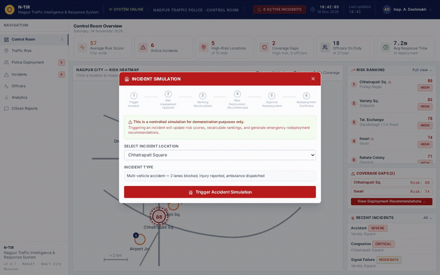
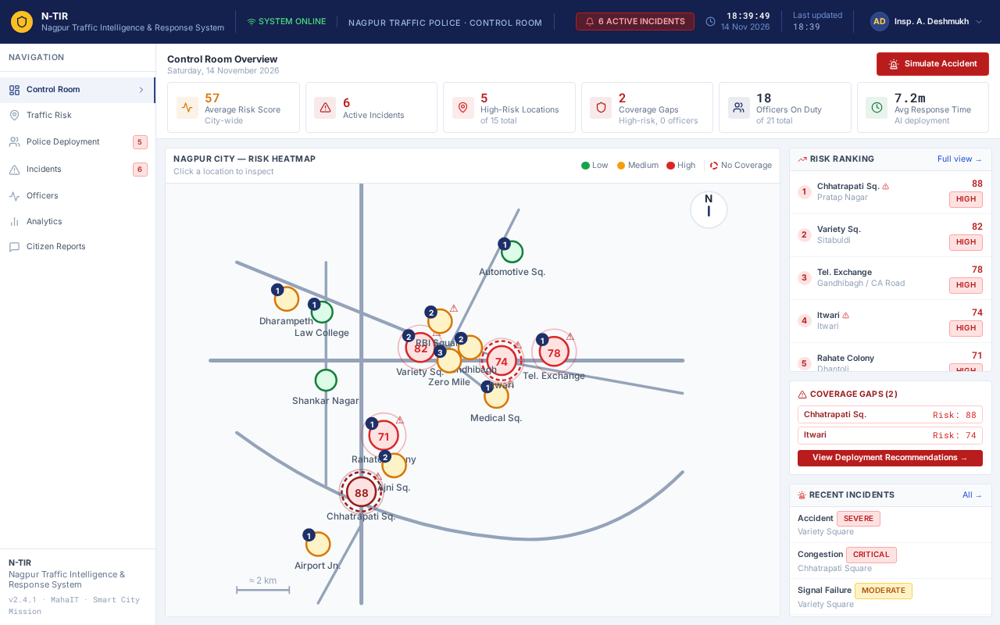
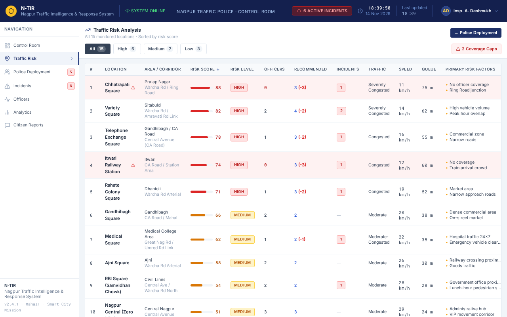
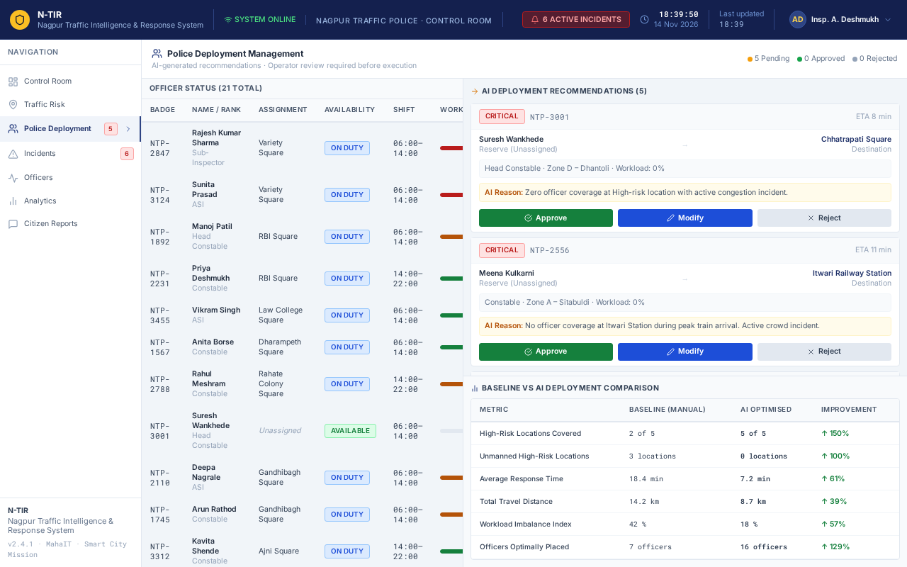

# Nagpur Traffic AI (N-TIR)

A prototype control-room dashboard for traffic police in Nagpur, built by a team of three. It ranks junctions by traffic risk, suggests where to send officers, and walks an operator through an accident response. The repo has two parts: a React + TypeScript dashboard (branded "N-TIR, Nagpur Traffic Intelligence & Response System") and a small FastAPI backend that wraps the TomTom traffic flow and Google Routes APIs.



*Recorded locally. Everything on screen comes from the mock data in `frontend/src/data/mockData.ts`; the dashboard does not call the backend.*

## Current state (read this first)

- The dashboard runs entirely on mock data (15 Nagpur junctions, 21 officers, sample incidents and citizen reports). The login screen accepts any username of 3+ characters and password of 4+ characters.
- The backend runs and serves three routes (`/health`, `/api/v1/traffic/flow`, `/api/v1/traffic/route`). The two traffic routes need your own TomTom and Google Maps keys. The frontend does not use them yet.
- There is no WebSocket server, ML model or test suite on `main`. An earlier version of this README described those; they were part of the first scaffold and were removed when the backend was restructured.

## Screenshots

| Control room | Traffic risk table |
| --- | --- |
|  |  |



*All screenshots recorded locally at 1280×800 with the repo's mock data.*

## Features (dashboard)

- **Control room**: an SVG map of central Nagpur with 15 junctions coloured by risk level, officer counts on each node, a risk ranking, a "coverage gaps" list (high-risk junctions with no officer), and recent incidents. Clicking a junction opens a detail panel.
- **Accident simulation**: a six-step walkthrough. Triggering an accident at Chhatrapati, Variety or Rahate Colony Square raises the risk score there (+20) and at two nearby junctions (+10), re-ranks the list, proposes sending the nearest available officer, and updates officer counts when you approve. "Reset Simulation" restores the earlier scores.
- **Traffic risk**: a sortable table of all junctions with risk score, officers present vs recommended, speed, queue length and risk factors, filterable by High / Medium / Low.
- **Police deployment**: officer roster with shift and workload, suggested deployments you can approve, modify or reject (approving moves the officer and updates junction counts), and a baseline vs suggested comparison table.
- **Incidents, Officers, Analytics, Citizen Reports**: further views over the same mock data; Analytics uses Recharts.

All of the above is client-side state in `frontend/src/store/appStore.tsx` (a `useReducer` store). Risk scores, recommendations and the comparison figures are fixed values in the mock data, not model output.

## Features (backend)

- `GET /health` returns service name and version.
- `GET /api/v1/traffic/flow?lat=&lng=` calls TomTom's Flow Segment Data API, then computes a congestion ratio `(freeFlow - current) / freeFlow` and labels it `FREE_FLOW`, `MODERATE` (≥ 0.15), `HEAVY` (≥ 0.35), `SEVERE` (≥ 0.65) or `CLOSED`.
- `POST /api/v1/traffic/route` calls Google's Routes API (`computeRoutes`, traffic-aware driving) and returns distance, free-flow duration, duration in traffic and the encoded polyline.
- Every response uses the same envelope (`success`, `data`, `message`, `meta`), and errors go through shared handlers that return `success: false` with an `error_code`.
- Routes are private by default: a custom `APIRoute` class adds a JWT check (RS256 keys fetched from `JWKS_URL`) unless the route sets `openapi_extra={"is_public": True}`. Both traffic routes are marked public.
- `backend/scripts/ingest_traffic_data.py` turns a TomTom MOVE traffic-stats GeoJSON export into a CSV with a congestion ratio and a LOW / MODERATE / HIGH / SEVERE label per road segment and time window. The input file is not in the repo, and the script needs `pandas`, which is not in `requirements.txt`.

Real output from the backend running locally with no API keys set:

```text
$ curl -s http://127.0.0.1:8000/health
{"status":"healthy","service":"Nagpur Traffic AI","version":"1.0.0"}

$ curl -s 'http://127.0.0.1:8000/api/v1/traffic/flow?lat=21.1458&lng=79.0882'
{"success":false,"message":"TomTom API key is not configured.","error_code":"HTTP_500_ERROR","details":null}

$ curl -s -X POST http://127.0.0.1:8000/api/v1/traffic/route -H 'Content-Type: application/json' \
    -d '{"origin_lat":21.1458,"origin_lng":79.0882}'
{"success":false,"message":"Data validation failed","error_code":"VALIDATION_ERROR","details":[{"location":"body -> dest_lat","message":"Field required","type":"missing"},{"location":"body -> dest_lng","message":"Field required","type":"missing"}]}
```

(Captured on port 4300; shown here with the default port 8000.) A successful `/traffic/flow` or `/traffic/route` call needs real TomTom or Google keys, so it was not recorded.

## Tech stack

- Frontend: React 18, TypeScript, Vite 5, Tailwind CSS 3, Recharts, lucide-react
- Backend: Python 3.11, FastAPI, Pydantic v2 + pydantic-settings, httpx, python-jose, slowapi
- External APIs (backend only, optional): TomTom Traffic Flow, Google Routes

## Run it locally

Requirements: Node 18+ and npm, Python 3.11 and [uv](https://docs.astral.sh/uv/) (or plain `pip`).

### Dashboard

```bash
cd frontend
npm install
npm run dev          # http://localhost:5173
```

Sign in with any username (3+ characters) and password (4+ characters). `npm run build` type-checks and builds to `frontend/dist`.

### Backend

```bash
cd backend
cp .env.example .env         # optional; every setting has a default
uv venv .venv --python 3.11
source .venv/bin/activate
uv pip install -r requirements.txt
uvicorn app.main:app --reload --port 8000
```

Interactive docs are at `http://localhost:8000/docs`. `./run.sh backend` and `./run.sh frontend` from the repo root do the same steps.

### Environment variables (`backend/.env`)

| Name | Purpose |
| --- | --- |
| `ENVIRONMENT` | `development` allows any CORS origin; anything else limits it to the localhost origins listed in `app/core/config.py` |
| `DEBUG` | Debug flag (read into settings) |
| `JWKS_URL` | JWKS endpoint used to verify RS256 bearer tokens on non-public routes |
| `AUTH_URL` | Token URL shown in the OpenAPI docs (defaults to `/api/v1/auth/login`) |
| `DATABASE_URL` | Postgres URL (read into settings, not used by any route yet) |
| `TOMTOM_API_KEY` | Needed for `GET /api/v1/traffic/flow` |
| `GOOGLE_MAPS_API_KEY` | Needed for `POST /api/v1/traffic/route` |

`docker-compose.yml` is not usable as-is: it builds `frontend/` from a `Dockerfile` that does not exist. The backend image (`backend/Dockerfile`) builds on its own.

## Project structure

```text
backend/
  app/
    main.py                 FastAPI app, CORS, error handlers, /health
    api/router.py           StandardizedRoute (adds JWT check unless is_public)
    api/endpoints/traffic.py  TomTom flow and Google Routes endpoints
    api/dependencies.py     JWT dependency, slowapi limiter
    core/                   settings, JWKS verification, error handlers
    schemas/                response envelope, request and response models
  scripts/ingest_traffic_data.py  TomTom MOVE GeoJSON -> CSV
docs/api/routes.yaml        OpenAPI description of the backend routes
frontend/
  src/App.tsx               login gate and page switcher
  src/store/appStore.tsx    app state, deployment and simulation logic
  src/data/mockData.ts      junctions, officers, incidents, deployments
  src/pages/                Control Room, Traffic Risk, Deployment, Incidents, ...
  src/components/           map, location panel, accident simulator, layout
run.sh                      ./run.sh backend | frontend
```

## Team

Built by three people; contributions below come from the git history.

- **[Krishanu1711](https://github.com/Krishanu1711)**: the React + TypeScript dashboard (all pages, the map, the accident simulator, the location detail panel, the operator profile modal, and the login page and naming changes).
- **[ShubhDubey16](https://github.com/ShubhDubey16)**: the first project scaffold, and a later commit with database models, an OR-Tools optimisation engine, a risk engine and an ML training script (`c200c2a`). That backend work is in the history but not in the current tree, which kept the restructured backend below.
- **[Abbas Nadir](https://github.com/abbasnadir)**: the restructured FastAPI backend (response envelope, error handling, JWKS auth, route template), the TomTom flow and Google Routes endpoints, the TomTom ingest script, the API docs in `docs/api/routes.yaml`, `run.sh`, and merging the branches.

There is no license file in this repo.
